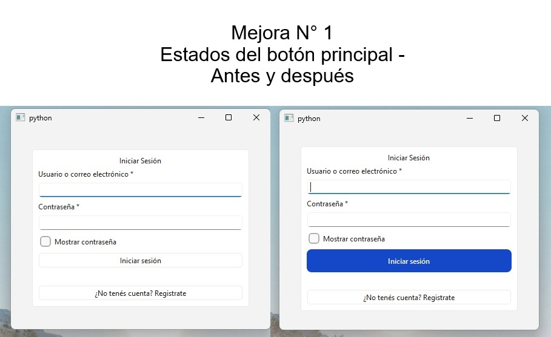
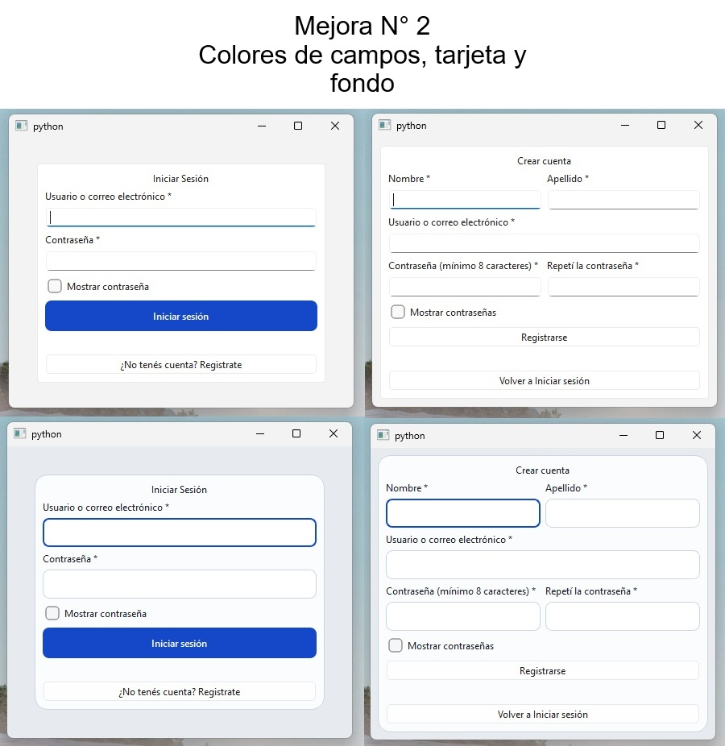
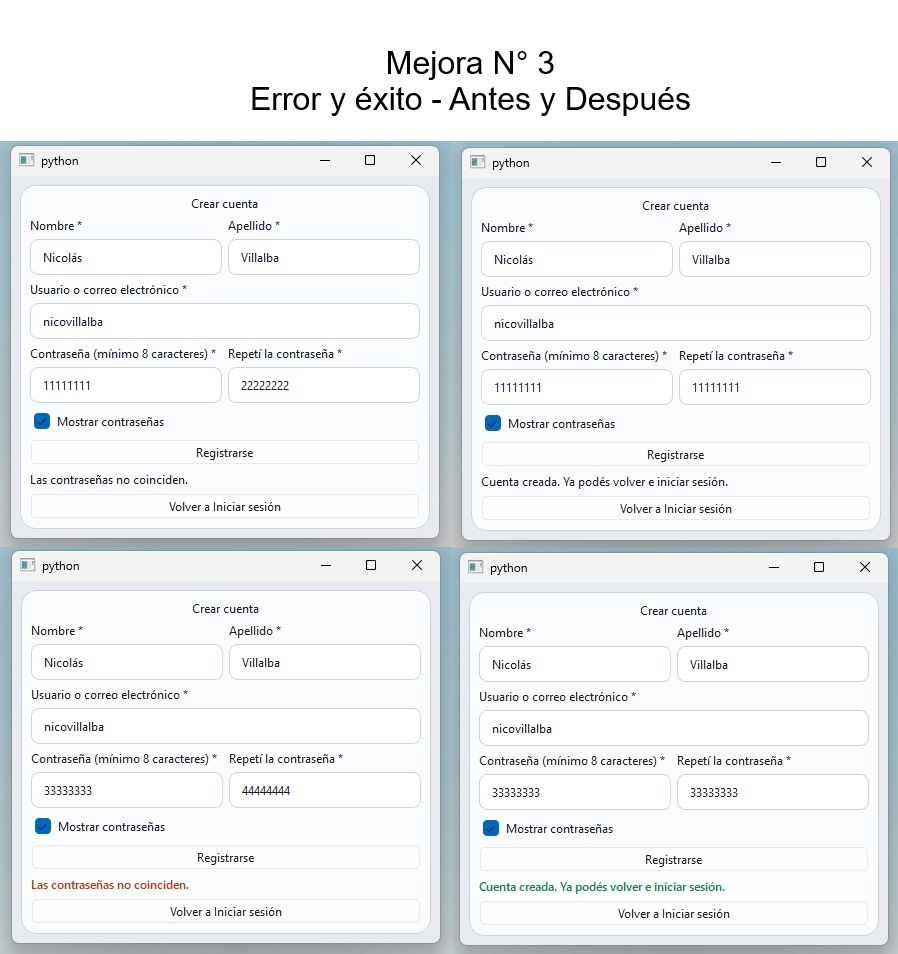

# Login y registro con PyQt6

Aplicación de escritorio con dos pantallas diseñadas en Qt Designer y controladas
con clases de Python. Trabajo práctico de Programación II.

> **Importante:** la autenticación es una SIMULACIÓN. Los usuarios viven en
> memoria y se pierden al cerrar la aplicación. No es un sistema seguro ni
> apto para datos reales.

## Capturas

## Requisitos
- Python 3.10 o más nuevo
- PyQt6 6.12.0 (ver `requirements.txt`)

## Instalación
Windows (PowerShell):

    py -m venv .venv
    .venv\Scripts\Activate.ps1
    python -m pip install -r requirements.txt

Si PowerShell bloquea la activación, ejecutar antes
`Set-ExecutionPolicy -Scope Process -ExecutionPolicy Bypass`

## Ejecución

    python main.py

## Funcionalidades
- [x] Login y registro diseñados en Qt Designer (`.ui`) y cargados con `uic.loadUi()`.
- [x] Una clase por pantalla: `VentanaLogin` y `VentanaRegistro`.
- [x] `VentanaPrincipal` (un `QStackedWidget`) alterna entre las dos pantallas en una sola ventana.
- [x] Mostrar u ocultar la contraseña (en el registro, las dos a la vez).
- [x] Enter en el campo de contraseña equivale a hacer clic en "Iniciar sesión".
- [x] Validación de formularios: campos obligatorios, contraseña de al menos 8 caracteres y confirmación igual a la contraseña.
- [x] Registro y login simulados con un único `ServicioAutenticacion` compartido por las dos pantallas.
- [x] La contraseña nunca se guarda: se guarda un hash con sal (PBKDF2-SHA256) en memoria.
- [x] El servicio vuelve a validar las reglas, aunque la pantalla ya lo haya hecho.
- [x] El login falla con un mensaje genérico ("Usuario o contraseña incorrectos"): no revela si el usuario existe.
- [x] Mensajes de error y de éxito con estilos distintos, definidos en `estilos.qss`.

## Limitaciones conocidas
- **No es un sistema seguro:** es una simulación para practicar, no apta para datos reales.
- **No persiste:** los usuarios se guardan en memoria y desaparecen al cerrar la app.
- **No limita intentos:** se pueden probar contraseñas sin parar.
- **No maneja sesiones:** "Sesión iniciada" es solo un mensaje, no un estado de la aplicación.

## Decisiones de diseño
**Arquitectura**
- El diseño (`.ui`) describe cómo se ve; el código Python decide qué pasa. Lo único que comparten es el `objectName` de cada widget.
- Cada pantalla sabe responder a sus botones y nada más. El cambio entre pantallas lo hace `VentanaPrincipal`, para que el login y el registro no se conozcan entre sí.
- El servicio de autenticación no importa PyQt6: no sabe que existen pantallas. Si más adelante se usa una base de datos, solo debería cambiar su interior.
- Un solo servicio, creado en `VentanaPrincipal` y entregado a cada pantalla por su constructor. Si cada pantalla creara el suyo, el registro y el login tendrían usuarios distintos.
- Las reglas de validación se revisan en la pantalla (para avisar rápido a la persona) y de nuevo en el servicio (que no depende de que la pantalla haya validado).
- La longitud mínima de la contraseña (8) está escrita una sola vez, en `autenticacion.py`.

**Mejoras visuales**
- **Estados del botón principal** (`:hover`, `:pressed`, `:disabled`): para que el botón responda al mouse y se distinga de lo demás.
- **Colores de campos, tarjeta y fondo**: para que la tarjeta se distinga del fondo y el campo activo se vea marcado al escribir.
- **Mensajes de error y de éxito**: Python solo indica el tipo de mensaje y el QSS decide cómo se ve. El texto también dice qué pasó, para no depender solo del color.

## Autores
Nicolás Villalba